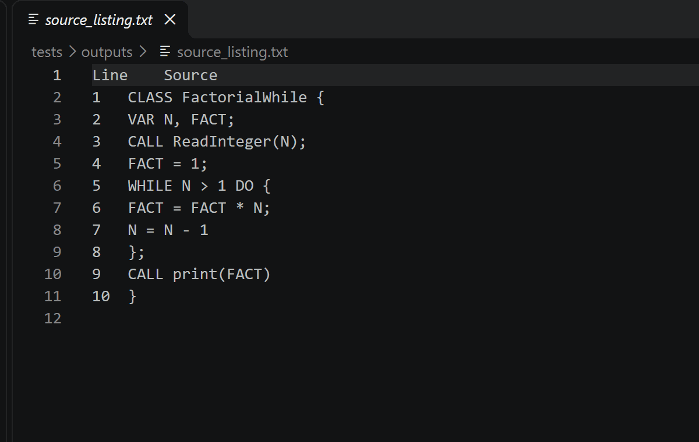
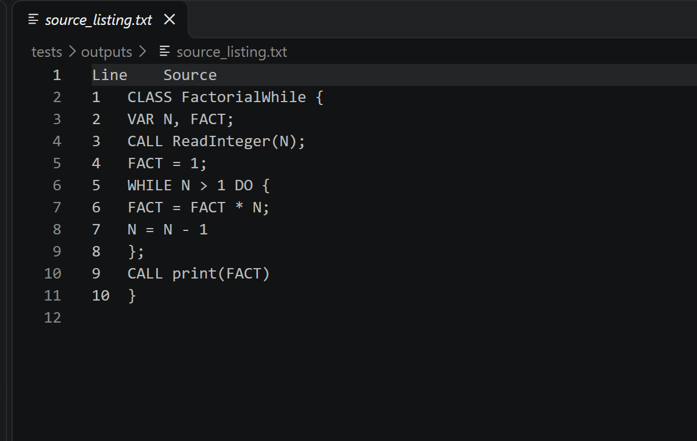
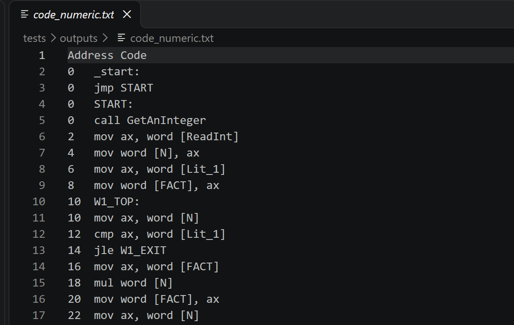
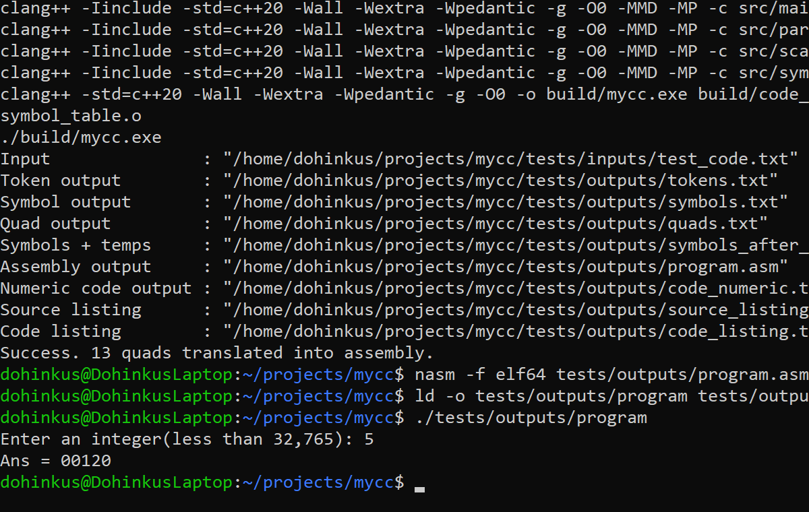
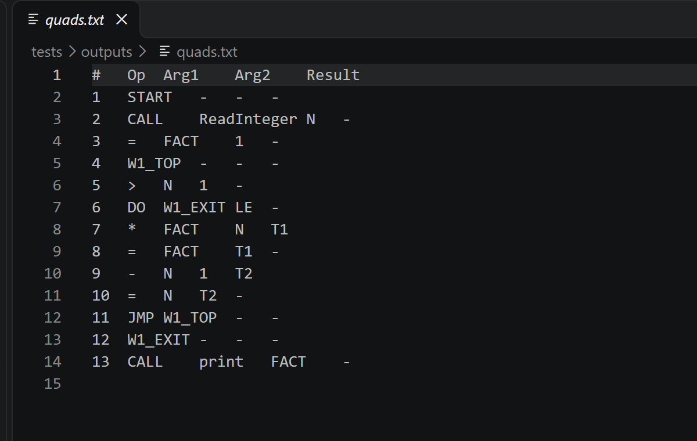
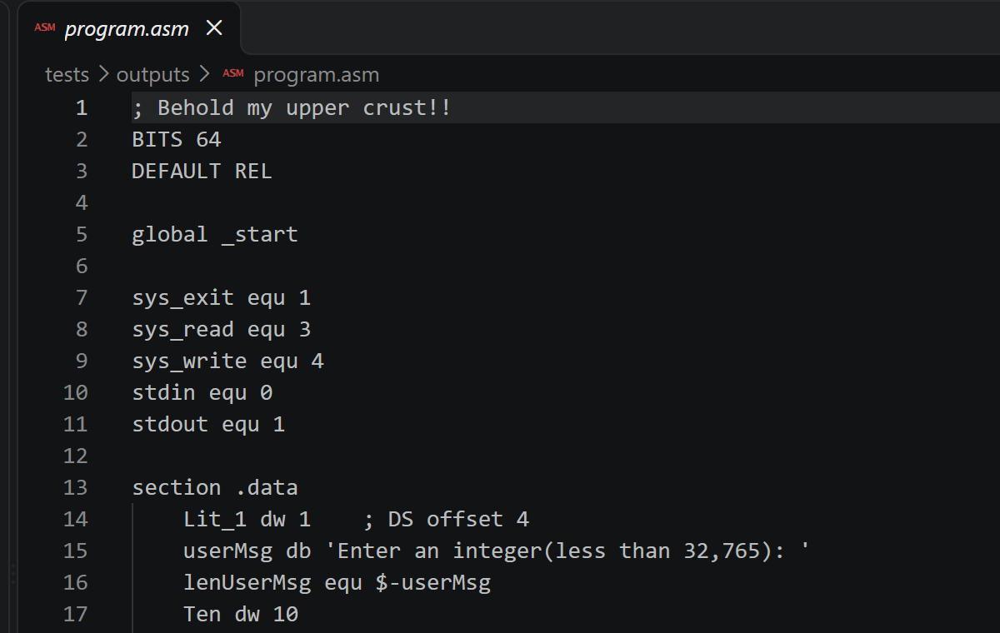

## Demo!! (GIF takes a few seconds to load)



*The GIF above takes a moment to load! It's a slideshow of a few output screenshots when I compiled and ran a test program with my compiler. Source -> quads -> x86 assembly -> a working program. IT FINALLY WORKS!!*

*I deliberately skipped a few output steps in the GIF, but they're still generated and used when ran, it's just faster/easier to view it working this way!*

# mycc - my little compiler with big ambitions :)

**A compiler built from scratch in C++20** for a small custom C-like programming language. It takes human-readable code, analyzes it in stages, generates **NASM-compatible x86 assembly**, and can produce a runnable Linux program! No magic, just a lot of careful translating and state machines!! :)

This started as a compiler-course project and became an exercise in understanding how languages work under the hood-from individual characters all the way to executable instructions.

## See it work

The example below computes a factorial using a `WHILE` loop. Enter **5**, and the compiled program prints **00120** (the leading zeros are part of its output format).

**1. Write a program** - the custom language has variables, expressions, loops, and simple input/output. This is the compiler's generated, line-numbered source listing.



<p align="center">⬇️ <strong>Compile it!</strong> ⬇️</p>

**2. Generate x86 instructions** - the compiler translates that loop into operations like `mov`, `cmp`, `jle`, and `mul`. This is its address-annotated instruction listing; it also writes an actual <code>program.asm</code> file.



<p align="center">⬇️ <strong>Assemble + link + run!</strong> ⬇️</p>

**3. Get the answer** - the terminal shows the compiler, NASM assembler, linker, and finally the generated executable producing a result!!!



<details>
<summary><strong>Curious about the in-between steps?? Peek under the hood here!!</strong></summary>

Before assembly, the parser produces *quads* (four-field intermediate instructions):



The compiler also generates a complete NASM source file, including the program's data, labels, and runtime support:



And the other outputs include `tokens.txt`, `symbols.txt`, `symbols_after_parse.txt`, `source_listing.txt`, and `code_listing.txt`.

</details>

## What it can do

- **Scan** source code into tokens with a table-driven finite-state automaton!
- **Build a symbol table** for declared identifiers.
- **Parse expressions and statements** and generate intermediate *quads*.
- **Translate quads into x86 assembly** and generate source/code listings.
- Handle **arithmetic, variables, constants, conditionals, loops, arrays, procedures, recursion, and integer I/O** in the included examples!

In short: `source -> tokens -> symbols -> quads -> x86 assembly -> executable`.

## Try it yourself (Ubuntu / WSL)

You'll need **Clang**, **Make**, **NASM**, and **binutils** (`ld`). On Ubuntu:

```bash
sudo apt update
sudo apt install -y clang make nasm binutils
```

From the project root, choose the factorial demo and compile it:

```bash
cp tests/inputs/03_factorial_while_demo.txt tests/inputs/test_code.txt
make run
```

Then assemble, link, and execute the generated code:

```bash
nasm -f elf64 tests/outputs/program.asm -o tests/outputs/program.o
ld -o tests/outputs/program tests/outputs/program.o
./tests/outputs/program
```

Type `5` or another number when prompted. The expected printed result is `Ans = 00120` for `5` :)

**Try something else!** The `tests/inputs/` folder has six example programs covering arithmetic, comparisons, a `WHILE` loop, nested `IF` statements, recursive factorial, and arrays. Copy an example into `tests/inputs/test_code.txt` and rerun `make run`.

> **Note:** The compiler executable is called `build/mycc.exe` by the Makefile, even when built on Linux. Generated files go to `tests/outputs/` and are intentionally Git-ignored. The assembly instructions above target the Linux/WSL workflow shown in the demo.

## Project layout

```text
src/            Compiler implementation (scanner, parser, code generator, etc.)
include/        Headers and shared compiler types
tests/inputs/   Example programs and the active test_code.txt
assets/         Screenshots and animated demo for this README
Makefile        Build and run targets
```

This was by far my most fun "pure code" project so far at university.
